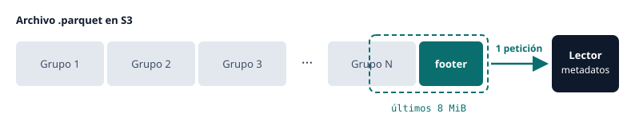
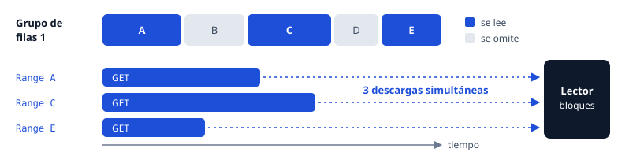
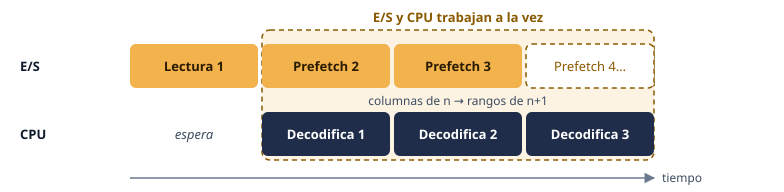
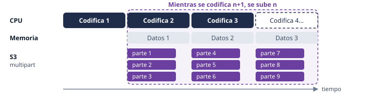

Cuando comencé a trabajar con Apache Parquet, el soporte nativo en Java se limitaba a archivos locales y al HDFS de Hadoop. El soporte de S3 se ofrece a través del módulo [`hadoop-aws`](https://hadoop.apache.org/docs/stable/hadoop-aws/tools/hadoop-aws/). Aunque es funcional, su uso obliga a incorporar el cliente de Hadoop al proyecto, lo que añade numerosas librerías transitivas pesadas, posibles vulnerabilidades de seguridad y configuraciones complejas.

<!--more-->

Las alternativas, como descargar objetos de S3 a un disco temporal local antes de leerlos, o escribir localmente antes de subirlos, introducen una sobrecarga de E/S y una latencia innecesarias.

Aunque Parquet nació dentro del ecosistema Hadoop, ligado a MapReduce y Spark, el formato de archivo en sí ya es independiente de la infraestructura de Hadoop, por lo que nada debería impedirnos usar S3 sin pasar por sistemas intermedios o complejas librerías.

Para cubrir esta carencia, **he implementado una librería que extiende `parquet-java` y permite trabajar directamente con cualquier servicio que implemente el protocolo de S3**. Gracias a ella, Carpet y otras librerías construidas sobre `parquet-java` pueden interactuar ahora directamente con S3.

El nuevo módulo `carpet-s3` actúa como un puente entre las abstracciones de entrada/salida de Parquet y el AWS SDK para Java, eliminando por completo la necesidad de dependencias de Hadoop.

## Añadir soporte para S3

Aunque ha surgido dentro del proyecto Carpet, el módulo `carpet-s3` se publica como un artefacto independiente que no depende de la librería principal `carpet-record`. Como implementa directamente las abstracciones `InputFile` y `OutputFile` de `parquet-java`, puedes usarlo en cualquier librería construida sobre `parquet-java` ([Parquet Avro](https://github.com/apache/parquet-java/tree/master/parquet-avro) o [Parquet Protobuf](https://github.com/apache/parquet-java/tree/master/parquet-protobuf)), tanto si utilizas Carpet como si no.

Para empezar, añade el módulo `carpet-s3` junto con tu configuración existente de Parquet o Carpet.

Con Maven:

```xml
<dependency>
    <groupId>com.jerolba</groupId>
    <artifactId>carpet-record</artifactId>
    <version>0.8.2</version>
</dependency>
<dependency>
    <groupId>com.jerolba</groupId>
    <artifactId>carpet-s3</artifactId>
    <version>0.8.2</version>
</dependency>
```

O con Gradle:

```groovy
implementation 'com.jerolba:carpet-record:0.8.2'
implementation 'com.jerolba:carpet-s3:0.8.2'
```

El módulo se basa en el AWS SDK para Java v2. Por defecto, resuelve las credenciales y las regiones automáticamente utilizando la [cadena de proveedores de credenciales](https://docs.aws.amazon.com/sdk-for-java/latest/developer-guide/credentials-chain.html) estándar de AWS, por lo que las aplicaciones que se ejecutan con roles de IAM, variables de entorno o perfiles locales de AWS funcionan sin configuración adicional.

## Leer un archivo Parquet desde S3

Leer archivos Parquet directamente desde S3 requiere únicamente usar la nueva implementación de `InputFile`: `S3InputFile`

```java
record Event(long id, String name, long timestamp) { }

InputFile inputFile = S3InputFile.of("s3://my-bucket/events/data.parquet");
List<Event> events = new CarpetReader<>(inputFile, Event.class).toList();
```

`S3InputFile` analiza la URI `s3://` para identificar el *bucket* y la *key* del objeto, y mediante el SDK de AWS realiza todas las peticiones *HTTP range* de bajo nivel para descargar los datos necesarios.

### Optimización de transferencias con proyecciones

Debido a que Parquet es un formato columnar, solo *pagas* por los datos que lees. Cuando mapeas un archivo a un record que contiene solo un subconjunto de los campos disponibles en el fichero, Carpet solicita únicamente los *column chunks* necesarios para esos campos, ahorrando operaciones de entrada/salida y tiempo de transferencia:

```java
record EventName(String name) { }

List<String> names = new CarpetReader<>(inputFile, EventName.class)
    .stream()
    .map(EventName::name)
    .toList();
```

En este caso, `S3InputFile` recupera únicamente los rangos de bytes correspondientes a la columna `name`. Las columnas no leídas nunca se descargan, lo que reduce significativamente el uso de ancho de banda y la latencia de E/S al consultar grandes conjuntos de datos en S3.

## Escribir un archivo Parquet en S3

Escribir archivos Parquet directamente en S3 sigue exactamente el mismo patrón. Simplemente pasa una instancia de `S3OutputFile` al *writer*:

```java
OutputFile outputFile = S3OutputFile.of("s3://my-bucket/events/output.parquet");

try (CarpetWriter<Event> writer = new CarpetWriter<>(outputFile, Event.class)) {
    writer.write(events);
}
```

Por debajo, `S3OutputFile` gestiona la transmisión de los datos generados por la librería de Parquet, y los envía directamente a S3 realizando en paralelo múltiples peticiones *multipart*, sin necesidad de archivos locales.

El artefacto resultante es un archivo Parquet estándar totalmente compatible con cualquier otra herramienta o motor del ecosistema, como Apache Spark, DuckDB o AWS Athena.

## Optimizaciones

Amazon S3 es un almacén de objetos, no un sistema de archivos tradicional. Los datos se recuperan a través de HTTP y tratar un objeto remoto de S3 con los mismos patrones que un archivo local de acceso aleatorio introduce ineficiencias.

La arquitectura de Parquet se basa en leer primero el *footer* del archivo (ubicado al final del mismo) para analizar el esquema, las ubicaciones de los grupos de filas y las estadísticas de las columnas, antes de poder leer cualquier dato real. Para leer el *footer*, Parquet hace múltiples peticiones.

Para minimizar la latencia y maximizar el uso del ancho de banda disponible, Carpet S3 implementa distintas optimizaciones tanto leyendo como escribiendo.

### Lectura

`S3InputFile` optimiza la lectura reduciendo el número de peticiones y paralelizando la descarga:

- **Caché del *footer*:** Hace una petición inicial de los últimos 8 MiB del archivo. En la gran mayoría de los casos, esta única solicitud recupera todo el *footer* con los metadatos, eliminando múltiples viajes de ida y vuelta a la red antes de que comience el procesamiento de datos real. En el caso de que el fichero sea pequeño, se cargará en memoria de una sola vez.

- **Lecturas por rangos en paralelo:** Una vez analizado el *footer*, e identificado qué columnas y qué bloques de datos hay que leer en cada grupo de filas, la carga se hace en paralelo para maximizar el ancho de banda usado.

- **Prefetching especulativo:** Mientras la CPU decodifica y procesa los datos de un grupo de filas, `S3InputFile` recupera de forma asíncrona los rangos de datos para el siguiente grupo de filas. Los bloques de datos a descargar se infieren de las columnas referidas en el anterior grupo de filas. Superponer la E/S y la ejecución de la CPU minimiza el tiempo de procesamiento.


### Escritura

Escribir en S3 presenta un desafío diferente. Parquet escribe los archivos secuencialmente por *row groups*, pero S3 permite subir los datos en paralelo y de forma asíncrona.

`S3OutputFile` saca partido de esto utilizando subidas *multipart* de S3: los datos de un *row group*, una vez codificados, se almacenan en memoria y, mientras se codifica el siguiente grupo de filas, se va subiendo el anterior mediante varias peticiones *multipart* en paralelo.




Todas estas optimizaciones internas de caché, lecturas en paralelo y transmisión multiparte, etc. están encapsuladas detrás de las interfaces estándar `InputFile` y `OutputFile` de `parquet-java`. Desde la perspectiva de la aplicación, leer y escribir desde/hacia S3 es equivalente a trabajar con archivos de disco local.

## Personalización de Carpet S3

Carpet S3 asume configuraciones por defecto, pero puedes personalizar el cliente S3 que se usa, y opciones de concurrencia y memoria.

### Ajustes de E/S y la concurrencia

Usando el *builder* disponible puedes ajustar cómo se hacen las transmisiones y la concurrencia de tu aplicación a la hora de realizar peticiones en paralelo:

- **Tamaños de las peticiones multipart:** Ajusta el número de bytes que se envían a S3 por petición.
- **Límites de concurrencia:** Establece el número máximo de solicitudes paralelas HTTP GET y PUT.
- **Executor personalizado:** Puedes proporcionar un `ExecutorService` dedicado para las tareas de E/S asíncronas y prefetching en segundo plano, asegurando que las operaciones de Carpet se ejecuten dentro de *thread pools* gestionados por ti.

```java
S3OutputFile outputFile = S3OutputFile.builder("s3://my-bucket/events/data.parquet")
    .partSize(30 * 1024 * 1024) // 30 MiB
    .concurrency(4)
    .build();

S3InputFile inputFile = S3InputFile.builder("s3://my-bucket/events/data.parquet")
    .prefetch(false)
    .executor(myExecutor)
    .build();
```

### Cliente S3

Para la mayoría de las aplicaciones desplegadas que usan S3, la configuración automática predeterminada del SDK de AWS evita tener que configurar nada mediante código.

Internamente, el AWS SDK resuelve credenciales, regiones y configuraciones de *endpoints* automáticamente a través de la cadena de proveedores por defecto: comprobando variables de entorno, propiedades del sistema, perfiles locales, metadatos de contenedores o roles de ejecución de IAM.

El SDK funciona también con cualquier solución de almacenamiento de objetos compatible con S3, incluyendo LocalStack para pruebas locales, Cloudflare R2, MinIO o Ceph.

Si tu aplicación necesita una configuración del cliente de S3 distinta de la predeterminada, como una región o un *endpoint* específicos, otros tiempos de espera o una política de reintentos personalizada, puedes proporcionar tu propio `S3Client` preconfigurado.

Para sobreescribir la configuración por defecto, o apuntar a un proveedor de S3 alternativo, configura el `S3Client` con un *endpoint* personalizado y tus credenciales:

```java
S3Client client = S3Client.builder()
    .endpointOverride(URI.create("https://<account-id>.r2.cloudflarestorage.com"))
    .credentialsProvider(StaticCredentialsProvider.create(
        AwsBasicCredentials.create("access-key", "secret-key")
    ))
    .region(Region.US_EAST_1)
    .build();

OutputFile outputFile = S3OutputFile.builder("s3://my-bucket/events/output.parquet")
    .withS3Client(client)
    .build();
```

## Desarrollo local

Una característica clave para simplificar el desarrollo de aplicaciones que puedan trabajar con S3 sin necesidad de disponer de un servicio S3 levantado es el uso transparente de rutas locales como *fallback*. `S3InputFile` y `S3OutputFile` inspeccionan el esquema de la URI configurada: si la ruta no empieza con `s3://` y corresponde a un archivo o una carpeta local, la librería delega las operaciones en la implementación para archivos locales.

Esta configuración utiliza el sistema de archivos local:

```java
void doSomething(String path) {
    InputFile inputFile = S3InputFile.of(path);
    ..
    OutputFile outputFile = S3OutputFile.of(path);
    ..
}

doSomething("/tmp/events.parquet");
```

Esto elimina la necesidad de incluir lógica `if/else` según la ruta de los archivos o de utilizar *wrappers* que abstraigan el sistema de archivos en tu lógica de negocio. Puedes escribir tus *pipelines* de datos usando `S3InputFile`/`S3OutputFile` en todas partes, ejecutar pruebas unitarias y de integración rápidas con archivos locales o directorios temporales y desplegar exactamente el mismo código en producción apuntando a un S3 real.

## Conclusión

Almacenar archivos Parquet en S3 es una práctica estándar en los *pipelines* de datos modernos. Sin embargo, interactuar con ellos desde aplicaciones Java históricamente obligaba a tomar una decisión: aceptar todas las dependencias pesadas que requiere Hadoop y su implementación de conexión con S3, o gestionar los ineficientes viajes de ida y vuelta al disco local.

`carpet-s3` ofrece una alternativa ligera y libre de Hadoop. Al integrarse directamente en la capa de E/S de bajo nivel de Parquet, proporciona caché del *footer*, lecturas por rangos en paralelo, subidas *multipart* en segundo plano y *fallback* a archivos locales. Todo ello a través de una API limpia e intuitiva. Como implementa las interfaces de `parquet-java`, puede adoptarlo cualquier aplicación Java que utilice `parquet-java`, independientemente de que use Carpet o no.

Lo más importante es que el modelo de programación se mantiene limpio y unificado: cambiar de un sistema de archivos local al almacenamiento en la nube es tan simple como cambiar un path por una URI `s3://`, sin necesidad de modificar tus modelos de datos, esquemas o lógica de procesamiento.

### Próximos pasos

Para configuraciones más avanzadas, como el ajuste de los búferes de carga/descarga, la ejecución con thread pools personalizados, propiedades del sistema y modos de pre-descarga, consulta la [Documentación de Carpet S3](https://carpet.jerolba.com/advanced/s3-files/).

El código fuente completo está alojado en [GitHub](https://github.com/jerolba/parquet-carpet/tree/master/carpet-s3), y los jars están disponibles directamente a través de [Maven Central](https://central.sonatype.com/artifact/com.jerolba/carpet-s3).